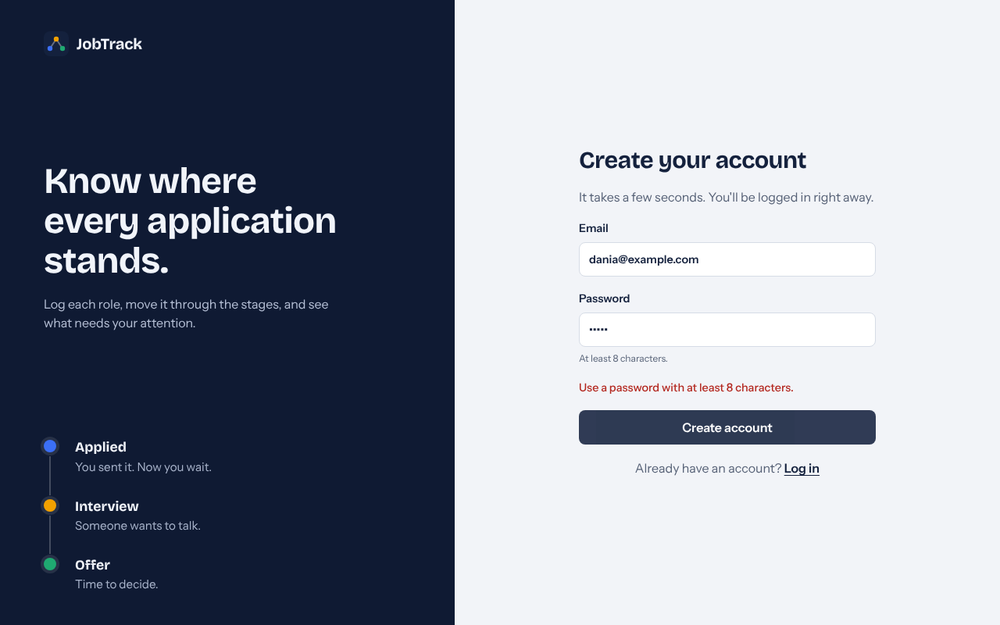
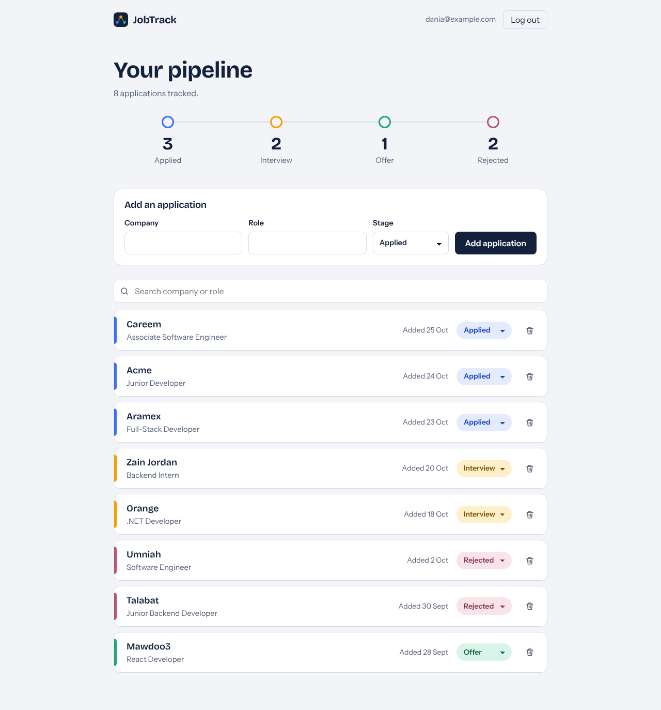

# JobTrack Web

A React front end for the [JobTrack API](https://github.com/daniahaitham/jobtrack-api). Log in, then track your job applications in one place.

## Features

- Log in with your JobTrack account
- See your applications as a list
- Add an application (company, role, status)
- Change an application's status from a drop-down
- Delete an application
- Search by company or role, and filter by status

## Tech stack

React, Vite, plain JavaScript, `fetch` for API calls.

## Run it locally

You need Node.js 20+ and the [JobTrack API](https://github.com/daniahaitham/jobtrack-api) running on `http://localhost:5000`.

```bash
git clone https://github.com/daniahaitham/jobtrack-web.git
cd jobtrack-web
npm install
npm run dev
```

Open http://localhost:5173.

There is no sign-up screen yet. Create an account with `POST /api/auth/register` in the API's Swagger page (`http://localhost:5000/swagger`), then log in here.





## How it works

- `src/App.jsx` shows the login screen or the list, depending on whether a token is saved.
- `src/Login.jsx` sends the email and password to the API and returns a JWT token.
- `src/ApplicationList.jsx` loads, adds, updates and deletes applications, sending the token in the `Authorization` header.

## Roadmap

- [ ] Sign-up screen
- [ ] Edit form for all fields (link, notes, dates)
- [ ] Dashboard with counts per status
- [ ] Board view with a column for each stage
- [ ] Deploy online

## Author

Dania Haitham, [github.com/daniahaitham](https://github.com/daniahaitham)